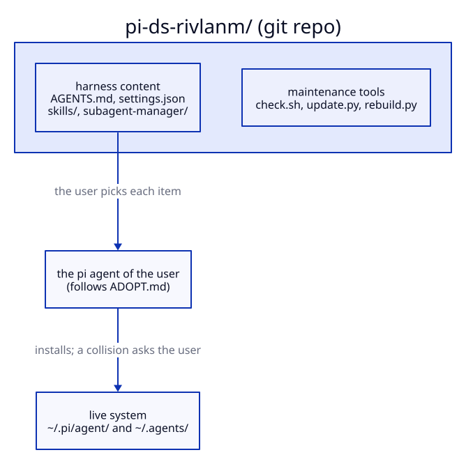
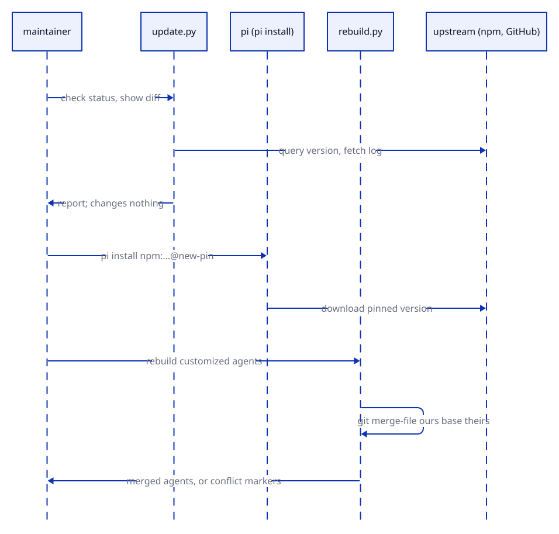

# pi-ds-rivlanm — a pi harness

This repo recreates the pi coding-agent harness on a new machine. It
holds the configuration, the skills, and a record of the source of each
external part.

## Layout

The repo mirrors the live system. `sync.sh` copies between the two
sides. The diagram shows the idea; the table gives the full list.



Diagrams in this document use the D2 theme Neutral Default.

- `tracked files`: everything that git sees. Push and pull both work.
- `local/`: gitignored. Push works; git never sees these files.
- `live system`: the directories that pi reads, `~/.pi/agent/` and
  `~/.agents/`.

| Path | Synced to | Contents |
|---|---|---|
| `AGENTS.md`, `settings.json`, `doc-preview-header.html` | `~/.pi/agent/` | Global instructions and pi settings |
| `skills/` | `~/.pi/agent/skills/` | Seven skills: six ours, `show-me` vendored from its upstream |
| `local/skills/`, `local/agents-skills/` | `~/.pi/agent/skills/`, `~/.agents/skills/` | Private skills. Gitignored |
| `subagent-manager/agents/` | `~/.pi/agent/subagent-manager/agents/` | Customized agents for pi-subagent-manager |
| `subagent-manager/upstream/` | — | Pristine shipped agents at the pinned version. Merge base for rebuilds |
| `manifest.toml` | — | Source and pinned version of each external part |
| `sync.sh` | — | Copies between the repo and the live system |
| `check.sh` | — | Reports missing tool dependencies, with install hints |
| `update.py` | — | Reports the status of each pin against upstream, with diffs |
| `rebuild.py` | — | Re-applies agent customizations after a package update |
| `tests/adoption/` | — | Docker test of the adoption flow |

## Install on a new machine

```sh
git clone https://github.com/rivera-lanasm/pi-ds-rivlanm.git ~/pi-harness
~/pi-harness/sync.sh push
```

If the machine already runs pi and has skills, read `ADOPT.md` first. It
moves the existing skills into `local/` before the first push.

When a live file differs, `push` backs it up before it replaces it. The
script does not touch secrets or state: `auth.json`, `sessions/`, `npm/`,
and `models-store.json` stay where they are. For `settings.json`, `push`
keeps the live `defaultProvider`, `defaultModel`, and `theme`; `pull`
filters them out. Both need jq.

Install pi itself and log in; this repo does not manage that step. Then
run `./check.sh`. It lists the tools that the skills expect and gives the
install command for each missing one. Missing tools disable only the
skills that need them.

## Keep the repo and the live system in sync

The live system holds copies. Edits on one side do not appear on the
other side until you sync:

```sh
./sync.sh pull    # live -> repo; then review with git diff
./sync.sh push    # repo -> live
```

`pull` touches only items that the repo already has. It never adds new
items. A skill that must stay out of git is never collected.

## Add a private skill

Put the skill directory in `local/skills/`. For the broad `~/.agents`
directory, use `local/agents-skills/`. Then run `sync.sh push`. Git
ignores `local/`: the skill works on this machine and never enters the
repo.

## Update an external part

```sh
uv run update.py                   # status of every external part
uv run update.py show-me           # upstream log and diffs for one part
```

`update.py` changes nothing. The diagram shows the flow: report, install
the pin, merge.



After you review the diff:

- **git skill** (`show-me`): merge the upstream changes into
  `skills/<name>`. Then set `base` in `manifest.toml` to the new upstream
  commit. The diffs show the upstream changes and our changes separately.
  `simple-english` was once tracked this way; it is now our own skill.
  See the note in `manifest.toml`.
- **npm package** (`pi-subagent-manager`):
  1. Set the new version in the pin in `settings.json` and in
     `manifest.toml`.
  2. Run `pi install npm:pi-subagent-manager@<new-pin>`. Do not use
     `pi update --extensions` for this step: it skips a pinned package
     that is not installed.
  3. Run `uv run rebuild.py`. This command three-way merges each
     customized agent in `subagent-manager/agents/` against the new
     installed version, with `subagent-manager/upstream/` as the base.
     Conflicts leave markers for manual resolution.
  4. Review with `git diff`. Then run `sync.sh push`.

## What is not in this repo, and why

- `auth.json` — credentials.
- `sessions/`, `models-store.json`, `npm/`,
  `subagent-manager/.import-offered` — state that pi regenerates.
- `bin/rg` — a binary. Install ripgrep through your package manager.
- `settings.json` holds no secrets, so git tracks it. It carries no
  provider, model, or theme. Those stay local: `push` keeps the live
  values and `pull` filters them out.
